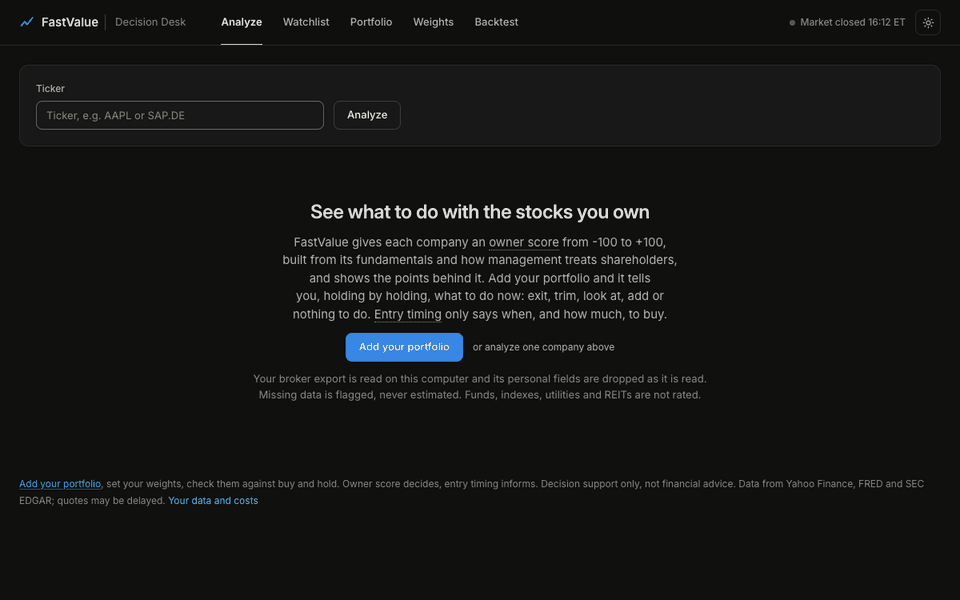

# FastValue

A multi-factor model of a complex adaptive system: the stock market.



I'm a value investor who also checks technical signals before buying. I wanted to check entries in a systematic way, and fast, so: FastValue. It scores a company against my checklist of green flags, tells me whether now looks like a good moment to enter, and lets me backtest all of it, on the market and on my own trades.

Why I built it and what I learned from it: [the blog post](https://martinvplopez.com/posts/fast-value/).

Not financial advice.

## What it does

- **Scores a company.** An owner score from the fundamentals (valuation, returns on capital, free cash flow) and how management treats shareholders (dilution, buybacks), from -100 to +100, with every rule behind it. Entry timing (trend, pullbacks, volume, market regime, VIX) is shown next to it and never votes.
- **Backtests.** Your settings on your portfolio or on one ticker, point in time on the S&P 500 since 2011 (SEC filings as they were filed, index members as they were), against buy and hold, the index and classic strategies. Trend and dip rules on any market, back to 1927 on the S&P 500.
- **Imports your broker history.** Trade Republic exports are read natively. Any other broker works through the FastValue CSV template (download it from the Portfolio tab or `/api/brokers/template`). You get your track record against MSCI World, the S&P 500 and the Nasdaq 100, your style in numbers, and a rules lab that replays your history under rules you didn't follow.
- **Watchlist and daily check.** Scan a list of tickers and get alerts when a score crosses a level.

## Everything stays local

- It runs on your machine. No account, no server, nothing connected to your broker.
- A broker export is read on your machine. Names, IBANs and descriptions are dropped as each row is read, and what's left is stored in `data/store/` (git-ignored).
- The repo ships no data. Prices, SEC filings and exchange rates are downloaded on first use into `data/cache/` (git-ignored). Only tickers and ISINs leave your machine, to look up public market data (Yahoo Finance, SEC EDGAR, FRED, the ECB).
- The extra news APIs and the social sources are off unless you set them in the environment.

## Run it

Python 3.10 or newer.

```bash
git clone https://github.com/martinvplopez/fastvalue.git
cd fastvalue
python -m venv .venv && source .venv/bin/activate
pip install -e ".[dev]"

python web/app.py        # dashboard at http://127.0.0.1:8501
```

The SEC asks for a contact in every request. Set it once in the app, or:

```bash
export SEC_USER_AGENT="fastvalue you@example.com"
```

From the command line:

```bash
python -m core.runner --multi-agent --ticker AAPL                          # owner score + entry timing
python -m core.runner --watchlist AAPL MSFT NVDA
python -m core.track_record --csv ~/Downloads/transactions_<from>_<to>.csv  # Trade Republic import + track record
python -m core.value_study                                                 # point-in-time S&P 500 study (about 10 minutes the first time)
pytest                                                                     # offline test suite
```

## More

- [docs/guide.md](docs/guide.md): every tab, agent, study and setting.
